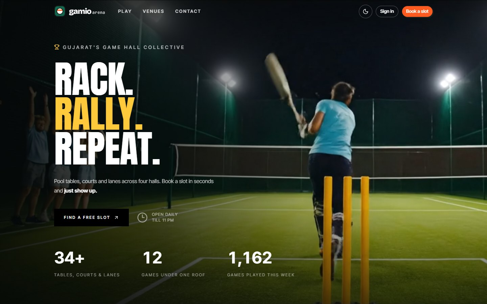

# Gamio Arena

Booking and front-desk software for multi-game venues: pool halls, table tennis clubs, badminton courts, bowling alleys, box-cricket turfs and gaming lounges. Players book a table online, the front desk runs the floor from a live board, managers set tables and prices, and the owner sees the numbers.

It runs on a single PC with a local SQLite database. No cloud account, no monthly fees and no paid APIs.



## The problem it solves

Most small game venues still run on a register book and phone calls. That leads to:

- Two groups turning up for the same table at the same time.
- Staff walking the floor to find out which tables are free.
- Cash at the counter not matching the bookings at closing time.
- No record of who played, who paid, or who changed what.

Gamio Arena puts every table, court and lane at every hall on one shared calendar that players, desk staff, managers and the owner all work from.

## What we provide

**For players**
- Browse halls and games, filter by city or game, and see live prices.
- Book one to four back-to-back slots, up to 30 days ahead.
- Pay at the counter or from a prepaid wallet.
- A ticket with a booking code to show at the desk.
- Free cancellation up to 2 hours before, with an automatic wallet refund.

**For the front desk**
- A live board of every table at the venue on a timeline.
- Walk-in bookings, check-in by code, finish and no-show.
- Marking counter payments as received, and wallet top-ups.

**For managers**
- Add and edit tables, courts and lanes, with normal and peak (evening/weekend) prices.
- Block time for maintenance, coaching or tournaments.
- Edit venue hours and details for the halls they manage.

**For the owner (admin)**
- A dashboard with today's games, how busy the floor is, money still to collect, monthly takings and trends.
- Staff and role management, game types, a contact inbox and an activity log of every change.
- CSV export of bookings.

**Under the hood**
- Four roles (player, front desk, manager, admin), each checked on the server and limited to their own venues.
- Double booking is prevented inside a database transaction.
- Light and dark themes, works on phones, and runs fully offline.

## Project structure

```
gamio-arena/
├── client/                     Website (React 19 + Vite)
│   ├── public/                 favicon, hero video
│   └── src/
│       ├── api/                requests to the server
│       ├── auth/               sign-in state and role checks
│       ├── components/         shared UI (icons, ticket, modals, charts)
│       ├── layouts/            site header/footer and console layout
│       ├── pages/
│       │   ├── site/           home, games, venue booking, sign in, contact
│       │   ├── account/        my bookings, wallet, profile
│       │   └── console/        dashboard, front desk, bookings, venues, admin
│       └── styles/             design tokens and page styles
├── server/                     API (Express 5 + SQLite)
│   ├── src/
│   │   ├── db/                 schema, demo data, backup, password reset
│   │   ├── http/               sign-in checks, errors, rate limiting
│   │   ├── lib/                time and slot calculations
│   │   ├── services/           bookings, wallet, permissions, activity log
│   │   └── routes/             public, player and console endpoints
│   └── test/                   automated tests
└── docs/screenshots/
```

## How to run

**Requirement:** [Node.js](https://nodejs.org) 22.13 or newer. No database server is needed.

```bash
git clone https://github.com/Harsh-Mandaliya/gamio-arena.git
cd gamio-arena
npm install
npm run dev
```

Open **http://localhost:5173**. The first start creates the database and fills it with demo halls, players and bookings.

Demo accounts (password `gamio123` for all):

| Role | Email |
| --- | --- |
| Player | `player@gamio.local` |
| Front desk | `desk@gamio.local` |
| Manager | `manager@gamio.local` |
| Admin | `admin@gamio.local` |

**Running it for a real venue (no demo data):** create `server/.env` with

```ini
DEMO_MODE=false
ADMIN_EMAIL=owner@yourvenue.in
ADMIN_PASSWORD=choose-a-long-password
```

then:

```bash
npm run build
npm start
```

The site and API run together on **http://localhost:4000**. Other devices on the same Wi-Fi can open `http://<this-pc-ip>:4000`.

**Other commands**

| Command | What it does |
| --- | --- |
| `npm test` | Run the automated tests |
| `npm run seed` | Reset the demo data |
| `npm run backup` | Save a copy of the database to `server/data/backups` |
| `npm run reset-password -- <email> <new password>` | Reset a locked-out account |

## Author

**Harsh Mandaliya** · [github.com/Harsh-Mandaliya](https://github.com/Harsh-Mandaliya)

## License

Released under the [MIT License](LICENSE). Copyright © 2026 Harsh Mandaliya.
