<div align="center">

# Gamio Arena

**Booking and front-desk software for multi-game venues: pool halls, table tennis clubs, badminton courts, bowling alleys, box-cricket turfs and gaming lounges.**

Players book a table online. The front desk runs the floor from a live board. Managers set prices and tables. Owners see the numbers.
Runs on a single PC with no cloud account, no monthly fees and no paid APIs.


</div>

---

## Contents

- [Why this exists](#why-this-exists)
- [Who uses it](#who-uses-it)
- [Features](#features)
- [Screenshots](#screenshots)
- [Quick start (try it in 2 minutes)](#quick-start-try-it-in-2-minutes)
- [A day at the venue](#a-day-at-the-venue)
- [Running it at a real venue](#running-it-at-a-real-venue)
- [Backups and recovery](#backups-and-recovery)
- [Configuration](#configuration)
- [How it works](#how-it-works)
- [API reference](#api-reference)
- [Project structure](#project-structure)
- [Development](#development)
- [Troubleshooting](#troubleshooting)
- [Roadmap](#roadmap)

---

## Why this exists

Most small game venues still run on a register book and WhatsApp. That breaks down quickly:

- Two groups turn up for the same table at 8pm.
- Nobody knows which tables are free without walking the floor.
- Cash at the counter doesn't match the bookings at closing time.
- Regulars ask "is anything free tonight?" and someone has to check by hand.

Gamio Arena puts every table, court and lane on one calendar that players, desk staff and owners all see. It's built for a single venue or a small chain, and it runs on the PC already at the front desk.

## Who uses it

| Where | How it helps |
| --- | --- |
| **Pool & snooker halls** | Hourly table booking with evening/weekend pricing, walk-ins on the live board, cash marked paid as it comes in. |
| **Table tennis & badminton clubs** | Court booking from 6am, block courts for coaching batches or tournaments, prepaid wallets for members. |
| **Bowling alleys & family entertainment centres** | Lane booking by the hour, group sizes up to the lane limit, one dashboard across several attractions. |
| **Box-cricket turfs** | Floodlit-hour pricing, 12-player bookings, deposits taken through the wallet. |
| **Gaming lounges (PS5 / VR)** | Bay booking in 30 or 60 minute slots, check-in by code at the counter. |
| **College, corporate & society clubhouses** | Fair, first-come booking of shared rec-room equipment with a record of who played when. |

## Features

### For players
- Browse every hall and game, filter by city or game, see live prices.
- Pick a table, a day (two weeks ahead), one to four back-to-back slots and the number of players.
- Pay at the counter or from a prepaid wallet.
- Get a ticket with a booking code (`GA-XXXXXX`) to show at the desk; printable.
- Cancel up to 2 hours before start; wallet payments are refunded automatically.
- Booking history and wallet statement.

### For the front desk
- **Live board**: every table at the venue on a timeline, colour-coded by status, with a "now" line.
- Click an empty stretch to book a walk-in (guest or registered player).
- Find a booking by code, check in, mark finished or no-show.
- Mark counter payments as received; see what's still to collect today.
- Top up player wallets (cash/UPI received at the counter).

### For managers
- Add, edit or retire tables, courts and lanes.
- Set slot length (30–120 min), capacity, normal price and peak price.
- Block time for maintenance, coaching or tournaments; it refuses if a booking is already there.
- Edit venue hours, address and description.
- Wallet corrections with a required reason.
- Only sees the venues they manage.

### For the owner (admin)
- Dashboard: games today, how busy the floor is, money to collect, month-to-date takings vs last month, 14-day trend, game mix, busiest tables.
- People & roles: create staff and managers, assign venues, pause accounts, reset passwords.
- Add new game types with their own icon and colour.
- Contact-form inbox.
- Activity log of every change (who cancelled, who took cash, who changed a price).
- CSV export of bookings for accounting.

## Screenshots

| | |
| --- | --- |
| 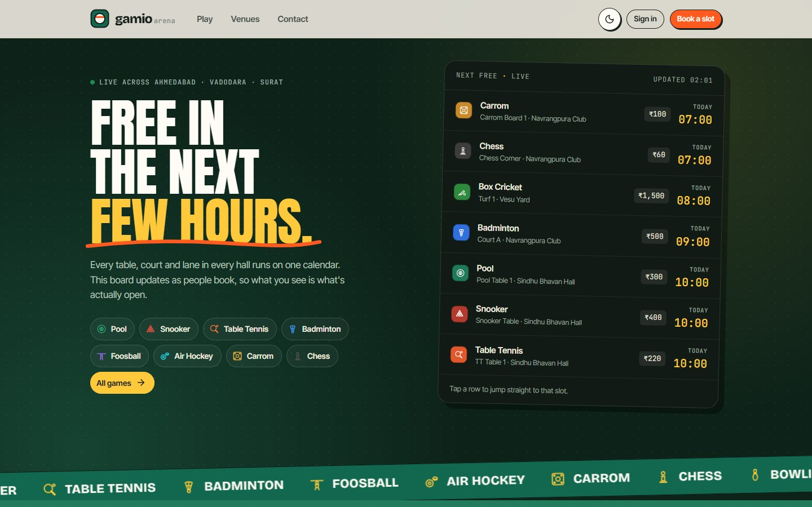 **Free right now**: the next open slot for every game, updated as people book. | 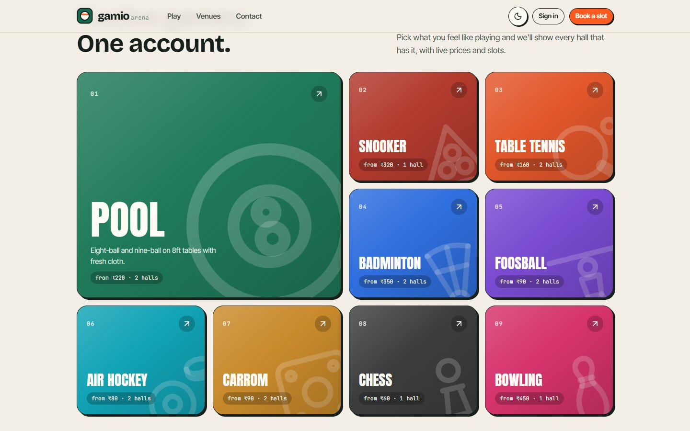 **Every game**, each with its own colour and icon. |
| 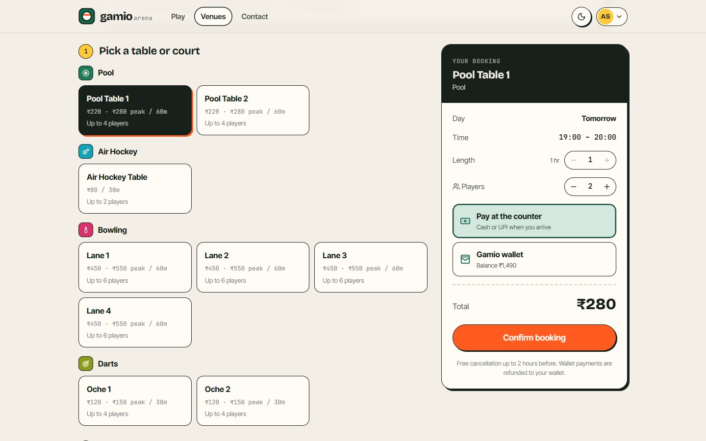 **Booking**: table, day, time, players and payment on one screen. | 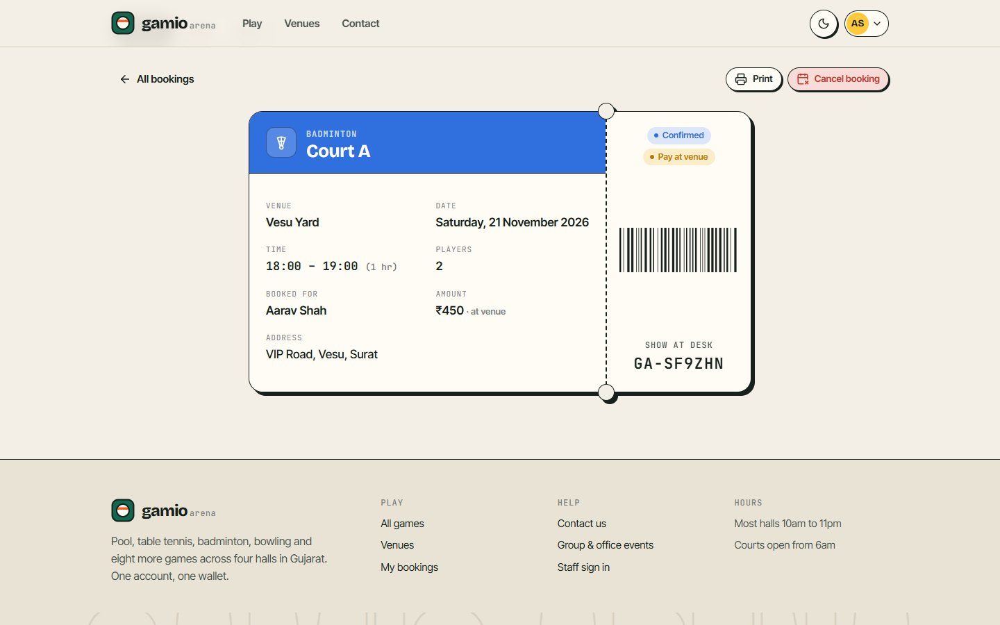 **Ticket** with the code the desk checks in. |
| 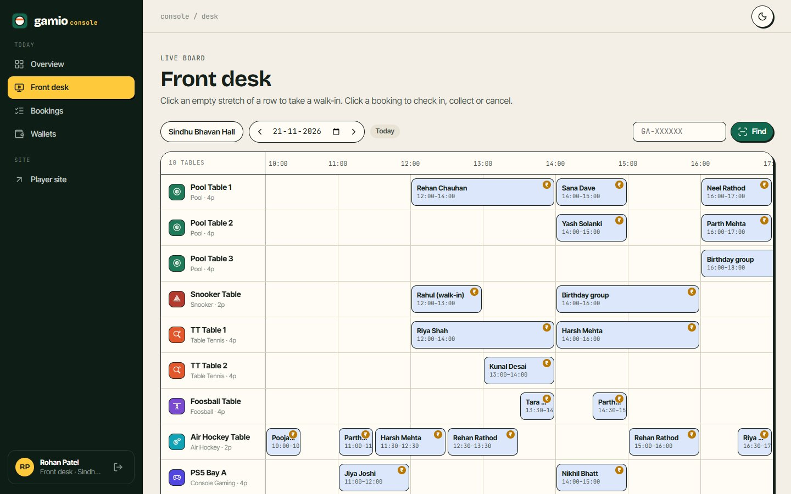 **Front desk board**: walk-ins, check-in, payments. | 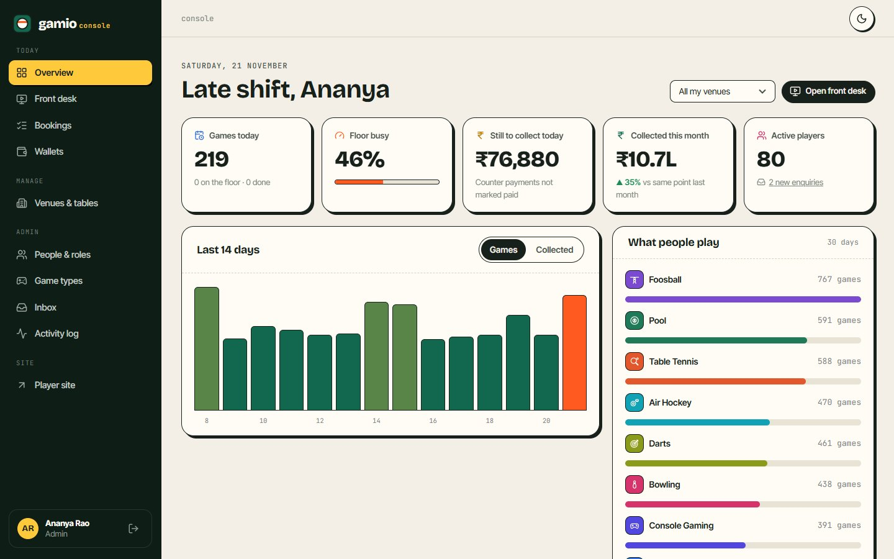 **Owner dashboard** with the day's and month's numbers. |
| 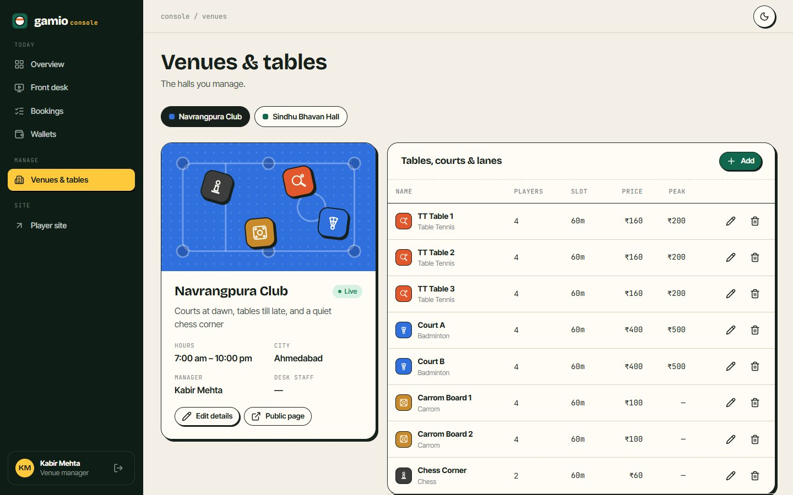 **Manager view**: tables, prices and blocked time. | 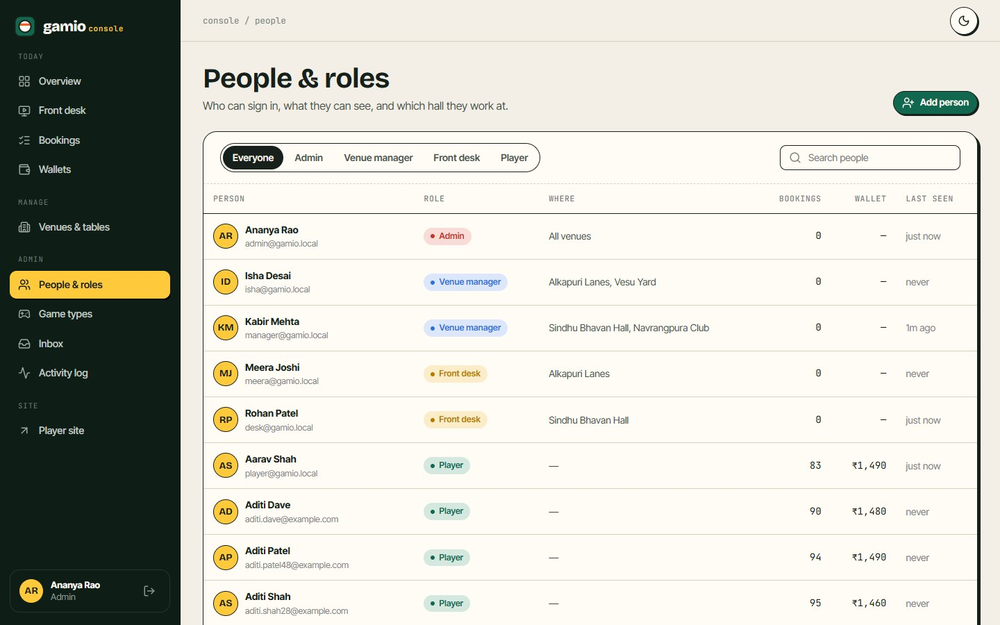 **People & roles**. |

<p align="center">
  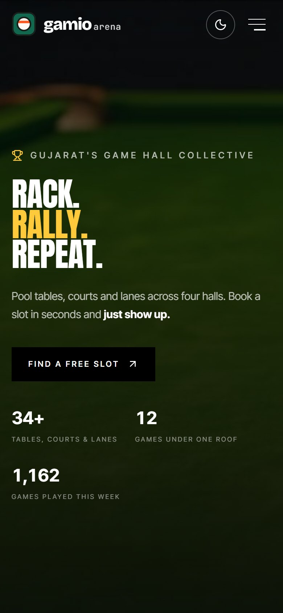
  &nbsp;&nbsp;
  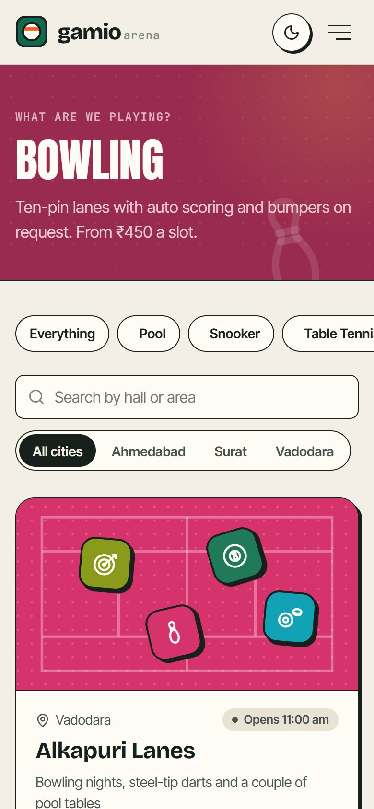
</p>

## Quick start (try it in 2 minutes)

**You need:** [Node.js](https://nodejs.org) **22.13 or newer** (the LTS download is fine). Nothing else, not even a database server.

```bash
git clone https://github.com/Harsh-Mandaliya/gamio-arena.git
cd gamio-arena
npm install
npm run dev
```

Open **http://localhost:5173**.

On first start the app creates `server/data/gamio.db` and fills it with demo data: 4 halls in Ahmedabad, Vadodara and Surat, 34 tables and courts, 80 players and about seven weeks of bookings, so every screen has something to show.

### Demo accounts

All use the password **`gamio123`**. The sign-in page lists them and fills them in with one click.

| Role | Email | Try this |
| --- | --- | --- |
| Player | `player@gamio.local` | Book a lane at Alkapuri Lanes, pay from the wallet, then cancel and watch the refund. |
| Front desk | `desk@gamio.local` | Open **Front desk**, click an empty slot to add a walk-in, then check them in. |
| Manager | `manager@gamio.local` | Open **Venues & tables**, change a price, block a table for an hour. |
| Admin | `admin@gamio.local` | Look at the dashboard, then **People & roles** and the **Activity log**. |

To start over with fresh demo data at any time: `npm run seed`.

## A day at the venue

A practical walk-through of how a hall uses it.

**Opening (front desk)**
1. Sign in on the desk PC and open **Console → Front desk**. The board shows today's bookings for your hall.
2. Anything blocked (cloth change, coaching batch) shows as a hatched bar.

**During the day**
- *Walk-in:* click the empty part of a table's row at the time they want, enter a name and phone, tick "Payment taken now" if they've paid, then **Book it**.
- *Player arrives with a booking:* type their code in the **Find** box, then **Check in**.
- *Cash or UPI at the end of a game:* open the booking, **Mark ₹… paid**, then **Finish game**.
- *Regular wants credit:* **Wallets**, search their name, choose an amount, **Add**.
- *Someone doesn't show:* open the booking, then **No-show**.

**Closing**
- **Overview** shows "Still to collect today". It should be ₹0 when every counter payment has been marked.
- **Bookings → Export CSV** gives the day's list for accounts.
- Run a backup (see below).

**Weekly (manager / owner)**
- Adjust peak prices if evenings are always full.
- Check **What people play** and **Busiest tables** to decide what to add or retire.
- Look through the **Activity log** if numbers don't add up.

## Running it at a real venue

For actual use, run one process on the front-desk PC and let phones and tablets on the venue Wi-Fi connect to it.

### 1. Install and configure

```bash
git clone https://github.com/Harsh-Mandaliya/gamio-arena.git
cd gamio-arena
npm install
```

Create `server/.env` (copy `server/.env.example`) and set at least:

```ini
DEMO_MODE=false
ADMIN_EMAIL=owner@yourvenue.in
ADMIN_PASSWORD=choose-a-long-password
JWT_SECRET=paste-any-long-random-text-here
```

With `DEMO_MODE=false` the first start creates **only** the game types and your admin account. No fake halls or players.

### 2. Build and start

```bash
npm run build
npm start
```

The whole app (website + API) is now on **http://localhost:4000**. Sign in with your admin email, then:

1. **Venues & tables → New venue**: add your hall, hours and address.
2. **Add** each table, court or lane with its price, peak price and slot length.
3. **People & roles → Add person**: create front-desk accounts (role *Front desk*, pick their venue) and managers.
4. Edit **Game types** if you offer something not in the list.

### 3. Let other devices connect

- Find the PC's local IP: run `ipconfig` (Windows) or `ip addr` (Linux) and look for something like `192.168.1.20`.
- On a phone or tablet on the same Wi-Fi, open `http://192.168.1.20:4000`.
- On Windows, allow Node.js through the firewall for **Private** networks when asked.

To let players book from home you'd put it behind a domain with HTTPS (for example a small VPS with Caddy or Nginx in front). The app needs nothing extra for that.

### 4. Keep it running

- **Windows:** Task Scheduler → *Create Task* → trigger *At log on*, action `cmd /c cd /d C:\path\to\gamio-arena && npm start`.
- **Linux:** a systemd service running `npm start` in the project folder, or [pm2](https://pm2.keymetrics.io/) (`pm2 start npm --name gamio -- start`).

### 5. Updating

```bash
git pull
npm install
npm run build
# restart the app
```

The database schema is created with `CREATE TABLE IF NOT EXISTS`, so your data stays in place.

## Backups and recovery

All data lives in one file: `server/data/gamio.db`.

```bash
npm run backup
```

This writes a consistent copy to `server/data/backups/gamio-YYYY-MM-DD_HHMM.db` (safe while the app is running) and keeps the newest 30. Schedule it daily, and copy the `backups` folder to a USB drive or cloud folder now and then.

**To restore:** stop the app, replace `server/data/gamio.db` with a backup file, delete `gamio.db-wal` and `gamio.db-shm` if present, and start again.

**Locked out of the admin account:**

```bash
npm run reset-password -- owner@yourvenue.in NewPassword123
```

## Configuration

Everything is optional; set values in `server/.env`.

| Variable | Default | What it does |
| --- | --- | --- |
| `PORT` | `4000` | Port for the API (and the built site after `npm run build`). |
| `DB_FILE` | `data/gamio.db` | SQLite file location, relative to `server/`. |
| `DEMO_MODE` | `true` | `true`: seed demo data on first start and show demo logins. `false`: start clean with one admin. |
| `ADMIN_EMAIL` | `admin@gamio.local` | Admin created on first start when `DEMO_MODE=false`. |
| `ADMIN_PASSWORD` | random | If empty, a random password is printed in the terminal once. |
| `JWT_SECRET` | random | Signs login tokens. If empty, one is generated into `data/jwt.secret`. |
| `CANCEL_WINDOW_HOURS` | `2` | Players can cancel (with refund) until this many hours before start. |
| `BOOKING_HORIZON_DAYS` | `30` | How far ahead bookings are allowed. |
| `BACKUP_DIR` | `data/backups` | Where `npm run backup` writes copies. |

## How it works

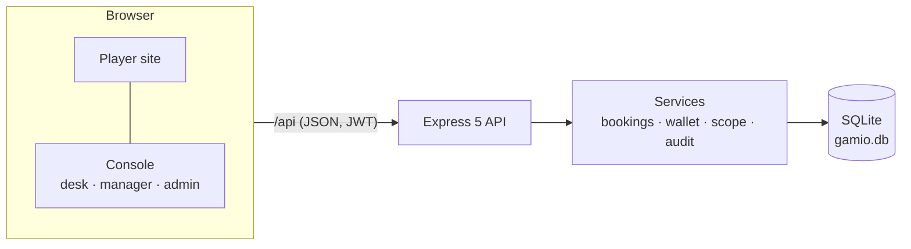

### Booking rules
- **Slots are calculated, not stored.** Each table's day is built from the venue's opening hours and the table's slot length, minus bookings and blocked time. Changing hours never leaves stale slots behind.
- **No double booking.** The availability check and the insert run inside one write transaction.
- **Peak pricing.** A table can have a peak price that applies to slots starting at 6pm or later, and all day on weekends.
- **Length.** One to four back-to-back slots per booking, all of which must be free.
- **Payment.** *Pay at counter* bookings are confirmed and marked unpaid until the desk records payment. *Wallet* bookings are paid immediately. No real money moves through the app; wallets are loaded at the desk.
- **Cancellation.** Players can cancel confirmed bookings until the cancellation window. Staff can cancel any time. Anything paid is refunded to the player's wallet.
- **Status flow:** `confirmed → checked_in → completed`, or `confirmed → no_show`, or `confirmed → cancelled`.

### Roles and access

Every API call is checked on the server; hiding a button is never the only protection.

| Role | Can see and change |
| --- | --- |
| Player | Their own bookings and wallet. |
| Front desk | Bookings, walk-ins and wallet top-ups at **their one venue**. |
| Manager | Everything the desk can do, plus tables, prices, blocks and venue details for **the venues they manage**. |
| Admin | Everything, every venue, plus people, game types, inbox and the activity log. |

### Data model

| Table | Holds |
| --- | --- |
| `users` | Everyone who signs in: role, home venue (for desk staff), wallet balance. |
| `venues` | Halls: address, hours, accent colour, manager. |
| `activities` | Game types (Pool, Bowling…) with icon and colour. |
| `resources` | Bookable units: a pool table, a court, a lane. Capacity, slot length, prices. |
| `bookings` | Who, what, when, players, amount, payment method/status, booking status. |
| `blocks` | Time a resource is unavailable, with a reason. |
| `wallet_transactions` | Ledger of top-ups, booking debits, refunds and corrections with running balance. |
| `enquiries` | Contact-form messages. |
| `audit_log` | Who did what, when. |

Money is stored in whole rupees, dates as `YYYY-MM-DD`, times as `HH:MM` in the venue's local time. The full schema is in [`server/src/db/schema.sql`](server/src/db/schema.sql).

## API reference

All endpoints are under `/api` and return JSON. Signed-in requests send `Authorization: Bearer <token>`.

**Public**

| Method | Path | Purpose |
| --- | --- | --- |
| `POST` | `/auth/register` | Create a player account, returns a token |
| `POST` | `/auth/login` | Sign in, returns a token |
| `GET` | `/meta` | Settings the site needs (cities, horizon, demo mode) |
| `GET` | `/activities` | Game types with table counts and starting prices |
| `GET` | `/venues?activity=&city=&q=` | Venues, filterable |
| `GET` | `/venues/:slug` | One venue with its tables |
| `GET` | `/resources/:id/slots?date=` | A table's slots for a day with price and state |
| `GET` | `/highlights` | Headline numbers and the next free slot per game |
| `POST` | `/enquiries` | Contact form |

**Signed-in player** (`/me`)

| Method | Path | Purpose |
| --- | --- | --- |
| `GET` / `PATCH` | `/auth/me` | Profile |
| `POST` | `/auth/me/password` | Change password |
| `GET` | `/me/bookings` | Upcoming and past bookings |
| `POST` | `/me/bookings` | Book: `{ resourceId, date, start, slotCount, players, paymentMethod }` |
| `GET` | `/me/bookings/:code` | One booking |
| `POST` | `/me/bookings/:code/cancel` | Cancel |
| `GET` | `/me/wallet` | Balance and statement |

**Console** (`/console`, staff and above, scoped to their venues)

| Method | Path | Role | Purpose |
| --- | --- | --- | --- |
| `GET` | `/overview?venueId=` | desk | Dashboard numbers |
| `GET` | `/schedule?venueId=&date=` | desk | Live board data |
| `GET` / `POST` | `/bookings` | desk | Search and filter / create walk-in |
| `GET` | `/bookings/:code` | desk | Look up by code |
| `PATCH` | `/bookings/:id` | desk | Check in, finish, no-show, mark paid |
| `POST` | `/bookings/:id/cancel` | desk | Cancel with refund |
| `GET` | `/players?q=` | desk | Player search |
| `POST` | `/wallet/topup` | desk | Load a wallet |
| `POST` | `/wallet/adjust` | manager | Correction with reason |
| `GET` / `POST` / `PATCH` | `/venues`, `/venues/:id` | manager (create: admin) | Venues |
| `POST` / `PATCH` / `DELETE` | `/venues/:id/resources`, `/resources/:id` | manager | Tables and courts |
| `GET` / `POST` / `DELETE` | `/venues/:id/blocks`, `/blocks`, `/blocks/:id` | manager | Blocked time |
| `GET` / `POST` / `PATCH` | `/users`, `/users/:id` | admin | People and roles |
| `POST` / `PATCH` / `DELETE` | `/activities`, `/activities/:id` | admin | Game types |
| `GET` / `PATCH` | `/enquiries`, `/enquiries/:id` | admin | Inbox |
| `GET` | `/audit` | admin | Activity log |

Errors look like `{ "error": "message", "fields": { "email": "Enter a valid email" } }` with the usual HTTP status codes (400, 401, 403, 404, 409, 429).

## Project structure

```
gamio-arena/
├── client/                     React 19 + Vite
│   ├── public/                 favicon, hero video, theme bootstrap
│   └── src/
│       ├── api/                fetch wrapper with token handling
│       ├── auth/               session context, role guard
│       ├── components/         icons, venue art, ticket, modal, toasts…
│       │   ├── console/        booking panel, walk-in form, charts
│       │   └── showcase/       video hero, game carousel, figurines
│       ├── hooks/              data loading, page titles
│       ├── layouts/            site header/footer, console shell
│       ├── lib/                formatting, roles, status labels
│       ├── pages/
│       │   ├── site/           home, explore, venue booking, sign in/up, contact
│       │   ├── account/        my bookings, ticket, wallet, profile
│       │   └── console/        overview, front desk, bookings, wallets, venues, admin
│       └── styles/             tokens, base, components, page styles
├── server/                     Express 5 + node:sqlite
│   ├── src/
│   │   ├── db/                 schema, connection, seed, backup, password reset
│   │   ├── http/               auth middleware, errors, rate limiting
│   │   ├── lib/                time maths, slot builder, booking codes
│   │   ├── services/           bookings, wallet, venue scope, audit log
│   │   └── routes/             public, auth, player and console routes
│   └── test/                   booking rules and API tests
└── docs/screenshots/
```

## Development

```bash
npm run dev        # API on :4000 (auto-restart) + site on :5173 (hot reload)
npm test           # 15 tests: slot layout, booking rules, roles, API
npm run seed       # wipe and reload demo data
npm run build      # production build of the site into client/dist
npm start          # serve API + built site on :4000
```

**Stack:** React 19, React Router 7, Vite, Express 5, SQLite through Node's built-in `node:sqlite`, Zod for validation, JWT + bcrypt for sign-in, Lucide icons. Fonts are bundled, so the app works fully offline.

**Design:** pool-felt green, chalk blue and scoreboard orange on warm paper, with ink outlines like a printed club card. Each game has a custom icon, venue covers are drawn from the hall's colours, and the theme follows the system's light/dark setting.

**Tests** run against an in-memory database and cover: slot generation and peak pricing, double-booking prevention, wallet debit and refund, capacity limits, the cancellation window, venue scoping for desk staff, walk-in rules, and role checks on the API.

## Troubleshooting

| Problem | Fix |
| --- | --- |
| `No such built-in module: node:sqlite` | Node is too old. Install Node 22.13+ and check with `node -v`. |
| `EADDRINUSE: address already in use :4000` | Something else uses the port. Set `PORT=4100` in `server/.env`. |
| Site shows "Can't reach the Gamio server" | The API isn't running. Use `npm run dev` (both together), not only the client. |
| Tablets on Wi-Fi can't open the site | Use the PC's IP and port 4000 after `npm run build && npm start`; allow Node through the firewall. |
| Demo data looks stale (all bookings in the past) | `npm run seed` regenerates it around today's date. |
| Forgot admin password | `npm run reset-password -- email newpassword` |

## Roadmap

- SMS / WhatsApp reminders through a local gateway
- Recurring bookings for coaching batches and leagues
- Membership plans with included hours
- Tournament brackets and leaderboards
- Multi-language interface (Gujarati, Hindi)
